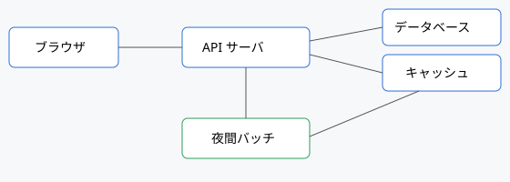

# システム構成

この文書では、サービス全体の構成と、それぞれの部品の役割を説明します。
細かい設計の判断については、各 ADR (設計判断の記録) を見てください。



## 全体像

利用者はブラウザから画面を開き、画面は API サーバにリクエストを送ります。
API サーバはデータベースとキャッシュを使って処理し、重い集計は夜間のバッチに任せます。
すべての部品はクラウド上のコンテナで動いており、構成はコードで管理しています。

| 部品 | 使っている技術 | 担当チーム |
|---|---|---|
| フロントエンド | React、TypeScript、Vite | 画面チーム |
| API サーバ | Rust、axum | 基盤チーム |
| データベース | PostgreSQL 16 | 基盤チーム |
| キャッシュ | Redis | 基盤チーム |
| バッチ | Rust、cron | データチーム |
| 監視 | Prometheus、Grafana | 基盤チーム |

## フロントエンド

画面は React と TypeScript で作っています。ビルドには Vite を使います。
画面ごとにファイルを分け、API の呼び出しは共通の関数にまとめています。

- 状態管理は、画面をまたぐものだけを共通の仕組みに置き、それ以外は各画面の中で持つ。
- API の型定義は、API サーバ側の定義から自動で生成する。手で書かない。
- 画面の文言は 1 か所にまとめ、あとから多言語化できるようにしている。

## バックエンド

API サーバは Rust の axum で作っています。データベースは PostgreSQL 16 です。
リクエストを受けてから返すまでの流れは、次のとおりです。

1. 認証を確かめる。方式は [認証方式](../api/auth.htm) を参照。
2. 入力を検証する。不正な値なら 400 を返す。
3. キャッシュにあればそれを返す。
4. なければデータベースに問い合わせ、結果をキャッシュに入れてから返す。

```rust
async fn get_user(State(app): State<App>, Path(id): Path<i64>) -> Result<Json<User>, ApiError> {
    if let Some(user) = app.cache.get_user(id).await? {
        return Ok(Json(user));
    }
    let user = app.db.find_user(id).await?.ok_or(ApiError::NotFound)?;
    app.cache.put_user(&user).await?;
    Ok(Json(user))
}
```

### キャッシュ

API サーバでは Redis を使い、セッションと検索結果を 5 分間キャッシュします。
データを更新したときは、関係するキャッシュをその場で消します。古い値を返し続けないためです。

## バッチ

売上の集計やレポートの作成など、時間のかかる処理は夜間にまとめて動かします。
バッチは API サーバとは別のコンテナで動くので、昼間の利用者に影響しません。

| ジョブ | 実行時刻 | 所要時間の目安 |
|---|---|---|
| 日次売上の集計 | 毎日 2:00 | 15 分 |
| 検索用の索引の作り直し | 毎日 3:00 | 30 分 |
| 古いログの削除 | 毎週日曜 4:00 | 10 分 |

### キャッシュ

バッチ側は、途中の計算結果をクラウドのストレージにキャッシュします。
処理が途中で止まっても、最初からやり直さずに済むようにするためです。
(この見出しは、同じ名前の見出しが 2 つあるときの目次の動きを確かめるためにも使っています。)

## 監視

すべての部品の状態は Prometheus で集め、Grafana のダッシュボードで見られます。
エラー率や応答時間が基準を超えると、オンコールの当番に通知が飛びます。
通知を受けたあとの動き方は [障害対応フロー](../runbooks/incident.html) にまとめています。

## 関連文書

- [ADR-001 データベースに PostgreSQL を採用する](adr-001-database.md)
- [デプロイ手順](../runbooks/deploy.md)
- [API エンドポイント一覧](../api/endpoints.html)
